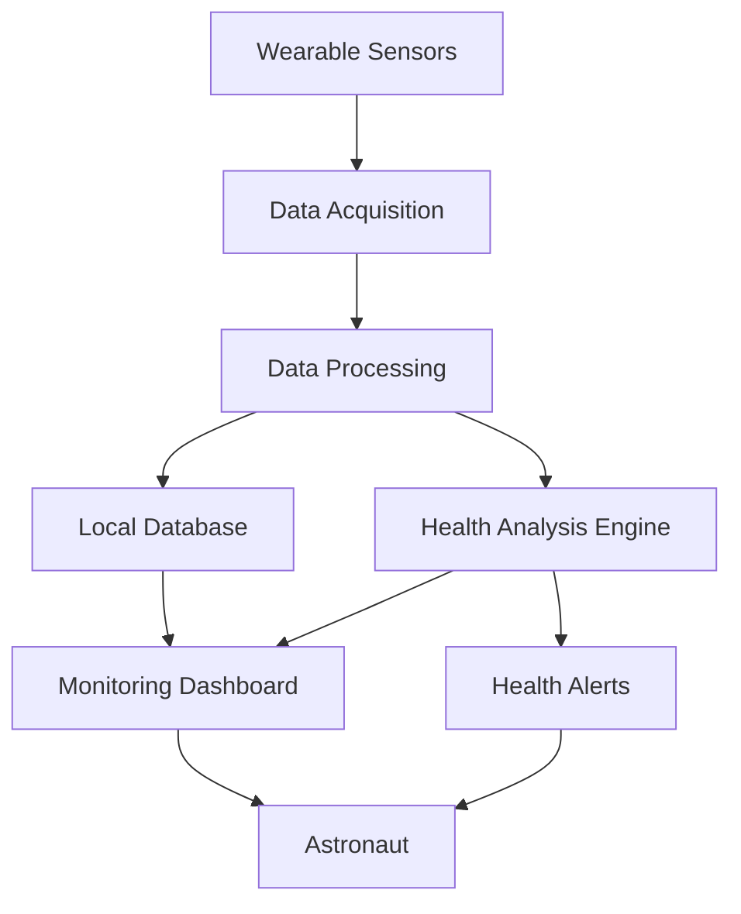

# 🚀 HEALTH
## Astronaut Health Monitoring System

### NASA Space Apps Challenge 2026

**Monitoring Astronaut Health and Well-Being Beyond Earth**

---

## 🌌 About the Project

**HEALTH** is an innovative astronaut health monitoring project developed for the **NASA International Space Apps Challenge 2026**.

The project aims to improve astronaut health, safety, and well-being during long-duration space missions.

Space exploration exposes astronauts to unique physical and psychological challenges, including microgravity, isolation, sleep disturbances, cardiovascular changes, and muscle loss.

Our solution proposes an intelligent health monitoring system that combines wearable technology, physiological sensors, data analysis, and an interactive dashboard.

By continuously collecting and analyzing health information, HEALTH aims to help astronauts better understand their physical condition and maintain their well-being throughout space missions.

---

## 🎯 Project Mission

Our mission is to develop an accessible, intelligent, and reliable system capable of monitoring astronaut health during space exploration.

The project focuses on three fundamental pillars:

- ❤️ Physical Health Monitoring
- 🧠 Mental Health and Well-Being
- 🤖 Intelligent Health Data Analysis

We believe that protecting human health is essential for the future of space exploration.

---

## 🚀 The Challenge

Astronauts face several health risks during space missions.

Some of the most significant challenges include:

### 🦴 Bone Density Loss

Microgravity reduces mechanical loading on bones, contributing to bone mineral density loss.

### 💪 Muscle Atrophy

Without Earth's gravity, muscles experience reduced mechanical demand, potentially resulting in decreased strength and endurance.

### ❤️ Cardiovascular Changes

Spaceflight can alter cardiovascular regulation and physical conditioning.

### 😴 Sleep Disorders

Irregular schedules, environmental conditions, and circadian rhythm disruption can affect sleep quality.

### 🧠 Psychological Stress

Isolation, confinement, and demanding mission conditions can influence psychological well-being.

### 🩺 Limited Medical Assistance

During deep-space missions, communication delays can make immediate medical support from Earth difficult.

These challenges highlight the importance of developing autonomous health monitoring technologies.

---

## 💡 Our Solution

HEALTH proposes an integrated health monitoring platform designed specifically for astronauts.

The system combines wearable sensors, intelligent software, and data visualization tools to provide information about astronaut health.

### Main Components

**1. Smart Wearable Device**

A wearable device designed to collect physiological measurements.

**2. Health Monitoring Software**

A software platform responsible for receiving, processing, and organizing health information.

**3. Intelligent Data Analysis**

Algorithms designed to identify patterns and unusual variations in physiological measurements.

**4. Interactive Dashboard**

A visual interface that allows astronauts to monitor their health information.

**5. Well-Being Monitoring**

A dedicated module for monitoring psychological well-being, stress, fatigue, and sleep quality.

---

## ⚙️ Proposed Features

### ❤️ Heart Rate Monitoring

Continuous or periodic heart rate monitoring using compatible sensors.

Potential capabilities:

- Heart rate visualization
- Resting heart rate analysis
- Exercise heart rate monitoring
- Historical cardiovascular trends
- Personalized monitoring alerts

### 🫁 Blood Oxygen Monitoring

Monitoring of blood oxygen saturation (SpO₂) using compatible sensors.

The system aims to provide accessible respiratory-related information while accounting for sensor limitations.

### 😴 Sleep Monitoring

Analysis of sleep patterns and rest periods.

Potential features:

- Sleep duration tracking
- Sleep schedule monitoring
- Sleep history
- Sleep consistency analysis
- Self-reported sleep quality

### 🧠 Mental Health and Well-Being

A dedicated module focused on psychological well-being.

Potential features:

- Daily mood assessments
- Stress level questionnaires
- Mental fatigue monitoring
- Emotional well-being tracking
- General wellness recommendations

### 💪 Physical Activity Monitoring

Monitoring physical activity and exercise participation.

Potential measurements include:

- Exercise duration
- Activity frequency
- Movement patterns
- Exercise history
- Recovery periods

### 🤖 Intelligent Health Analysis

Data analysis algorithms may be used to identify unusual patterns and changes in physiological indicators.

Potential capabilities:

- Anomaly detection
- Personalized health baselines
- Historical trend analysis
- Monitoring notifications
- Data visualization

Automated analysis is intended to support health awareness and does not replace professional medical evaluation.

---

## 🏗️ System Architecture

The proposed system architecture consists of five main layers.

### Architecture Overview

**Data Acquisition**

Collects physiological information from compatible sensors.

**Data Processing**

Validates, filters, and organizes incoming measurements.

**Data Storage**

Stores health information for historical analysis.

**Health Analysis**

Evaluates physiological trends and predefined monitoring conditions.

**User Interface**

Displays measurements, historical information, and monitoring notifications.

---

## 🛠️ Proposed Technologies

The following technologies are being considered for the system.

| Technology | Purpose |
|------------|---------|
| Python | Data processing and analysis |
| JavaScript | Frontend development |
| HTML5 | Interface structure |
| CSS3 | Interface styling |
| FastAPI | Backend API |
| SQLite | Local data storage |
| Pandas | Data analysis |
| NumPy | Numerical processing |
| Scikit-learn | Machine learning |
| Chart.js | Health data visualization |
| Bluetooth Low Energy | Wearable communication |

The final technology stack will depend on implementation requirements and available hardware.

---

## 🧠 Well-Being Monitoring System

Mental health is an essential aspect of astronaut safety and mission performance.

Long-duration missions can expose astronauts to isolation, confinement, stress, and irregular sleep schedules.

HEALTH proposes a well-being monitoring module designed to support psychological health awareness.

### Daily Wellness Assessment

Astronauts may complete short daily questionnaires evaluating:

- Mood
- Stress
- Energy levels
- Mental fatigue
- Sleep quality
- General well-being

### Wellness Dashboard

The platform may display historical trends related to psychological well-being.

### Personalized Recommendations

The system may suggest general wellness activities based on user-reported information.

Examples include:

- Following regular sleep schedules
- Practicing approved relaxation techniques
- Maintaining physical activity
- Taking scheduled rest periods
- Contacting medical support when necessary

These recommendations are not intended to diagnose or treat medical conditions.

---

## 🔒 Security and Privacy

Astronaut health information must be protected.

The proposed system includes the following security requirements:

- Secure authentication
- Encrypted data storage
- Protected communication
- Role-based access control
- Data integrity verification
- Secure local backups
- Controlled access to medical information

Privacy and security are fundamental aspects of the system architecture.

---

## 🌐 Offline Functionality

Communication with Earth may be delayed or temporarily unavailable during space missions.

HEALTH is designed around a local-first approach.

The proposed system should support:

- Local health data storage
- Offline health monitoring
- Offline dashboard access
- Local alert generation
- Data synchronization when connectivity becomes available

This architecture aims to improve astronaut autonomy during long-duration missions.

---

## 🧪 Testing and Validation

The project development process includes several proposed testing stages.

### Functional Testing

Verify that software components operate correctly.

### Sensor Testing

Evaluate sensor communication and measurement collection.

### Data Processing Testing

Validate the accuracy and consistency of processed information.

### User Interface Testing

Evaluate usability and accessibility.

### Security Testing

Identify vulnerabilities and verify data protection mechanisms.

### Health Analysis Validation

Evaluate monitoring algorithms using appropriate datasets.

**Important:** The project is a prototype concept and is not currently presented as a certified medical device or flight-qualified system.

---

## 📈 Expected Impact

HEALTH aims to contribute to safer and more sustainable human space exploration.

Potential benefits include:

### 🚀 Greater Astronaut Autonomy

Providing astronauts with accessible information about their health.

### ❤️ Improved Health Awareness

Supporting the monitoring of physiological and psychological indicators.

### 📊 Better Data Organization

Combining multiple health measurements into a unified platform.

### 🧠 Psychological Well-Being Support

Encouraging regular monitoring of stress, fatigue, and emotional well-being.

### 🌍 Applications on Earth

Technologies developed for astronaut health monitoring may also inspire terrestrial applications in:

- Remote healthcare
- Wearable health technology
- Occupational health
- Isolated environments
- Personal wellness monitoring

---

## 🔮 Future Improvements

Future development may include:

- Advanced wearable sensor integration
- Personalized machine learning models
- Improved psychological well-being assessments
- Exercise monitoring integration
- Predictive trend analysis
- Enhanced offline functionality
- Medical team dashboards
- Additional physiological sensors
- Improved accessibility
- Validation with spaceflight-relevant datasets

---

## 🗺️ Development Roadmap

- [ ] Define system requirements
- [ ] Design wearable device architecture
- [ ] Select physiological sensors
- [ ] Develop initial software prototype
- [ ] Create health monitoring dashboard
- [ ] Implement physiological data collection
- [ ] Develop well-being assessment module
- [ ] Implement local data storage
- [ ] Integrate health analysis algorithms
- [ ] Test sensor communication
- [ ] Evaluate monitoring accuracy
- [ ] Improve user interface
- [ ] Conduct system validation
- [ ] Prepare project demonstration

---

## 👨‍🚀 Our Team

We are a multidisciplinary team participating in the NASA International Space Apps Challenge 2026.

Our goal is to combine technology, innovation, and scientific knowledge to develop solutions that contribute to the future of human space exploration.

We believe that collaboration and creativity are essential for solving the challenges of living and working beyond Earth.

---

## 🌎 NASA Space Apps Challenge 2026

The NASA International Space Apps Challenge is a global innovation event that brings together participants from different backgrounds to develop solutions inspired by challenges involving space and Earth.

Our project focuses on astronaut health monitoring and the development of technologies that support human well-being during space missions.

### 🔗 Project Page

[HEALTH — NASA Space Apps Challenge 2026](https://www.spaceappschallenge.org/2026/find-a-team/health/?tab=project)

---

## 📚 References

- [NASA](https://www.nasa.gov/)
- [NASA Human Research Program](https://www.nasa.gov/hrp/)
- [NASA Space Apps Challenge](https://www.spaceappschallenge.org/)
- [NASA Open Data](https://data.nasa.gov/)

---

## 📄 License

This project is currently under development.

Licensing information will be defined by the project team.

---

## 🚀 HEALTH

### Protecting Human Health Beyond Earth

**NASA Space Apps Challenge 2026**

*Innovation for the future of human space exploration.*

🌍 Earth • 🌕 Moon • 🔴 Mars • 🚀 Beyond

